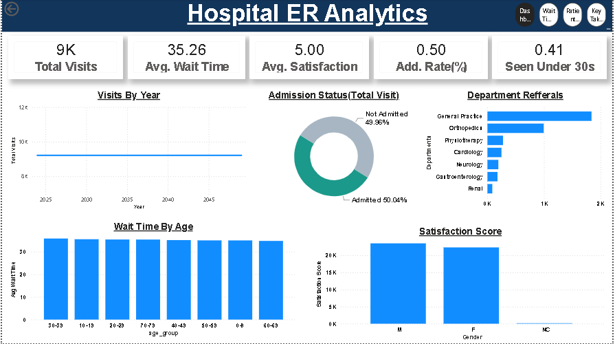
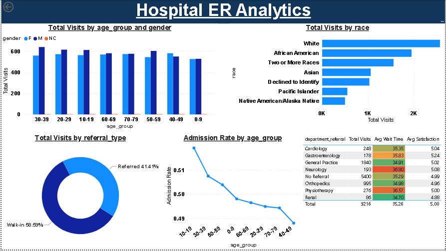
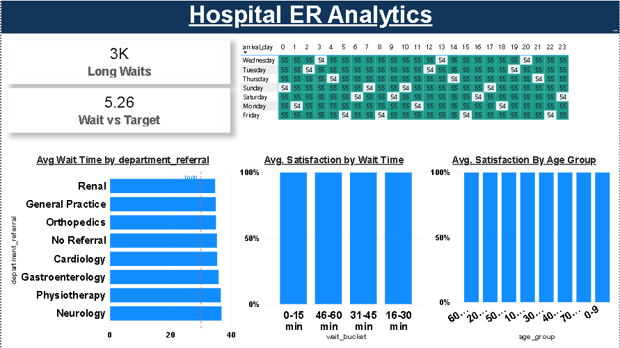
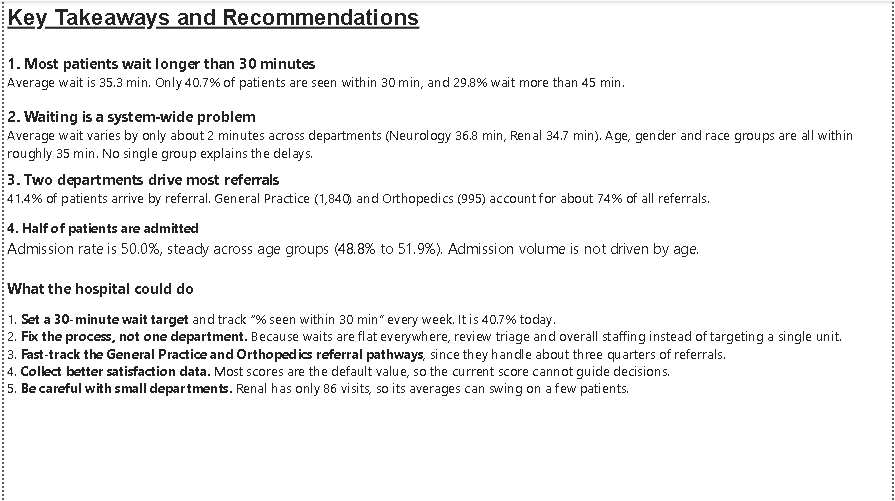

# Hospital ER Analytics: SQL + Power BI Dashboard on 9,216 Emergency Room Visits

> An end-to-end **healthcare data analytics project**: MySQL for cleaning and business questions, Power BI for a 4-page interactive dashboard, and a plain-English set of recommendations for reducing **emergency room wait times**.



**Tools:** MySQL · Power BI (DAX) · Excel · Jupyter/Python (cleaning)
**Topics:** hospital analytics · ER wait time analysis · patient flow · healthcare KPIs · SQL business questions · Power BI dashboard

---

## Table of Contents
1. [Business problem](#business-problem)
2. [Key findings](#key-findings)
3. [Recommendations](#recommendations)
4. [Dashboard walkthrough](#dashboard-walkthrough)
5. [SQL analysis](#sql-analysis)
6. [Data dictionary](#data-dictionary)
7. [Project structure](#project-structure)
8. [How to reproduce](#how-to-reproduce)
9. [Limitations](#limitations)
10. [About me](#about-me)

---

## Business problem
Emergency rooms are judged on how fast patients are seen. A hospital manager wants to know:

- How long do patients really wait, and is that a problem?
- Is the delay caused by one department, one age group, or the whole process?
- Where do referrals come from, and do admissions change by age?
- Can patient satisfaction be trusted as a performance measure?

## Key findings

| # | Finding | Evidence |
|---|---------|----------|
| 1 | **Most patients wait longer than 30 minutes** | Average wait is 35.3 min. Only **40.7%** are seen within 30 min and **29.8%** wait over 45 min |
| 2 | **Waiting is a system-wide problem** | Department averages differ by about 2 min (Renal 34.7 vs Neurology 36.8). Age, gender and race groups all sit near 35 min |
| 3 | **Two departments drive most referrals** | 41.4% of patients arrive by referral. General Practice (1,840) and Orthopedics (995) are about **74%** of referrals |
| 4 | **Half of patients are admitted** | Admission rate is 50.0%, steady across age groups (48.8% to 51.9%) |
| 5 | **Satisfaction data is not decision-ready** | Most scores are the default value, so the 5.00 average carries no signal |

## Recommendations
1. **Set a 30-minute wait target** and track "% seen within 30 min" weekly (40.7% today).
2. **Fix the process, not one department.** Waits are flat everywhere, so review triage and overall staffing.
3. **Fast-track General Practice and Orthopedics referral pathways** (about three quarters of referrals).
4. **Collect better satisfaction data** before using it to guide decisions.
5. **Treat small departments carefully.** Renal has only 86 visits, so its averages can swing on a few patients.

## Dashboard walkthrough
| Page | What it answers |
|------|-----------------|
| **Dashboard** | Total visits, average wait, admission rate, % seen within 30 min, referrals by department |
| **Patient Demographics** | Visits by age group, gender, race, referral type; admission rate by age group |
| **Wait Time & Operations** | Long waits, wait vs target, wait by department, arrival-hour heatmap |
| **Key Takeaways** | Findings and recommendations for non-technical stakeholders |





## SQL analysis
Database setup is in [`sql/Setup_sql_code.sql`](Setup_sql_code.sql) and the business questions are in [`sql/business_solutions.sql`](business%20solutions.sql).

Techniques used: `COUNT`, `AVG`, `CASE WHEN` bucketing, `GROUP BY`, subqueries, window functions (`SUM() OVER`), `DATEDIFF`, NULL handling.

| Question | Skill shown |
|----------|-------------|
| How many visits, any duplicate patient IDs? | Data validation |
| What date range does the data cover? | `MIN`/`MAX`, `DATEDIFF` |
| Average, min and max wait time? | Aggregations |
| Average satisfaction and missing scores? | NULL handling |
| Admission rate? | Conditional aggregation |
| Gender split and race breakdown? | `GROUP BY`, window % of total |
| Which departments get the most referrals? | Filtering, ranking |
| Referred vs walk-in share? | `CASE WHEN`, subquery |
| % seen within 30 minutes? | Boolean aggregation |
| Wait and satisfaction by department? | Multi-metric grouping |
| Satisfaction as wait time grows? | Bucketing |
| Admission rate by age group? | Segmentation |
| Top referral department per age group? | Ranking inside groups |

Example query:

```sql
-- What percentage of patients were seen within 30 minutes?
SELECT COUNT(*) AS total_patients,
       SUM(patient_wait_time <= 30) AS seen_within_30_min,
       ROUND(SUM(patient_wait_time <= 30) * 100 / COUNT(*), 2) AS pct_seen_within_30_min
FROM dataset;
```

## Data dictionary
| Column | Description |
|--------|-------------|
| `patient_id` | Unique visit/patient identifier |
| `add_date` | Date of the ER visit |
| `gender`, `age`, `race` | Patient demographics |
| `referral` | Referring department, or `No Referral` for walk-ins |
| `add_flag` | 1 if the patient was admitted |
| `satisfaction_score` | Patient score (largely default values, see Limitations) |
| `patient_wait_time` | Minutes waited before being seen |

Names (`patient_first_initial`, `patient_last_name`) are not used in the analysis.

## Project structure
```
hospital-er-analytics-sql-power-bi/
├── README.md
├── assets/            # dashboard screenshots
├── data/              # er_visits_clean.csv, er_visits_powerbi.csv, dim_date.csv
├── sql/               # Setup_sql_code.sql, business_solutions.sql
└── powerbi/           # Dashboard.pbix
```

## How to reproduce
1. Run `sql/Setup_sql_code.sql` in MySQL to create the `hospital_er` database and `dataset` table.
2. Import `data/er_visits_clean.csv` into the `dataset` table.
3. Run `sql/business_solutions.sql` to reproduce the SQL answers.
4. Open `powerbi/Dashboard.pbix` in Power BI Desktop (the report reads the CSV files in `data/`).

## Limitations
- The satisfaction column is mostly a default value, so satisfaction results are not reliable.
- Flat results across groups suggest the dataset is **simulated or sample data**, not a live hospital feed. Findings demonstrate the method.
- Small groups (for example Renal, 86 visits) produce unstable averages.

## About me
**Aayush Kumar Jha**, aspiring Data Analyst (SQL, Power BI, Excel, Python), Delhi, India.

- LinkedIn: [linkedin.com/in/aayushkumar-jha-84b7753bb](https://www.linkedin.com/in/aayushkumar-jha-84b7753bb)
- Portfolio: [databyaayush.github.io/myPortfolio](https://databyaayush.github.io/myPortfolio/)
- GitHub: [github.com/databyaayush](https://github.com/databyaayush)

If this project helped you, a star on the repo is appreciated.
